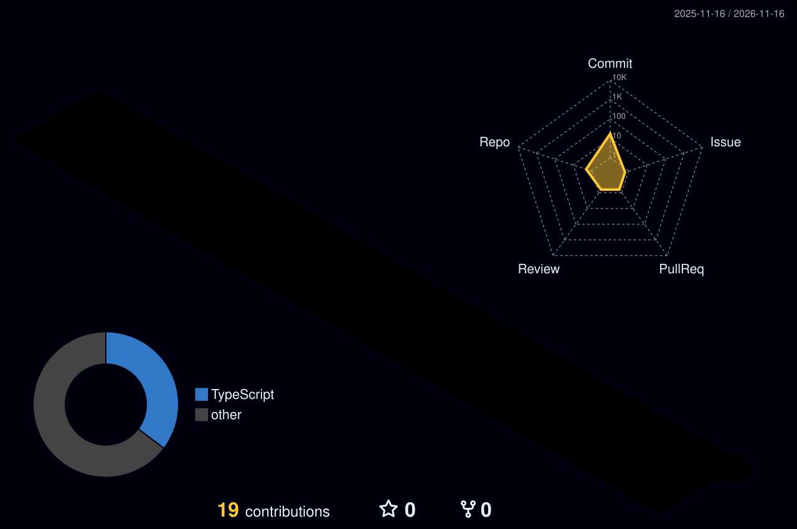

  

## I build websites people love to use, and make AI work inside them.

**You bring the idea. I make it look stunning, run fast, and get smarter with AI.**

 

## AI Tech Insight

<!-- INSIGHT:START -->

<!-- INSIGHT:END -->

 

 

 
<h3 align="left">Connect with me:</h3>

<h3 align="left">Languages and Tools:</h3>

                     

 

  

 

  

  

 
 

  

<!--  -->

<!-- 
 -->

 

 

 
<!--  -->

  

 

 

 

