  

  

  <strong> I build websites people love to use, and make AI work inside them.</strong>

You bring the idea. I make it look stunning, run fast, and get smarter with AI.

 

 
<h3 align="center">Languages and Tools:</h3>

  
  
  

 

# Automated Tech Insight

A continuously updated technology journal featuring software engineering, cybersecurity, networking, cloud computing, emerging technologies, and developer practices.

<!-- INSIGHT:START -->

<!-- INSIGHT:END -->

Concept, automation workflow and publication system by <strong>Muhammad Junaeid</strong>. AI-assisted content generation powered by Google Gemini.

Created by **Muhammad Junaeid**.

 
 

  

 

  

  

 
 

  

<!--  -->

<!-- 
 -->

 

 
<!--  -->

  

 

 

 

